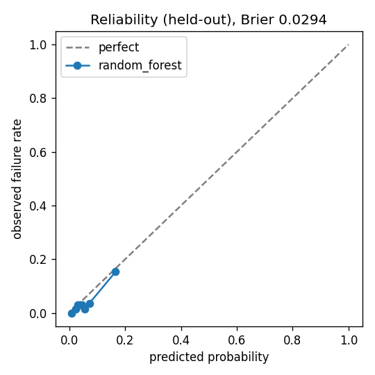

# Evaluation report — rf-20261011-142830

Reproduce: `python generate_data.py && python train.py` (seed 42). Every number below comes from that run.

## Data and target
- 40 machines, 1,041,236 readings, 2026-04-01 to 2026-10-10.
- Target: unplanned failure within 7 days of the prediction time (one snapshot per machine per day, 00:00 UTC).
- Planned changeovers / maintenance are not failures: corrective orders opened inside a planned stop are dropped
  (1 found).
- Snapshots: 6,591; failure rows: 370 (5.6%) -> heavily imbalanced.
- Rows with a suspected sensor fault: 93 (no failure score is given for them).

### What pre-failure behaviour looks like (EDA)
| days_before_failure | rows | vib_vs_base_3d | temp_vs_base_3d | vib_slope_7d |
|---|---|---|---|---|
| 0 | 52 | 0.4 | 1.292 | 0.192 |
| 1 | 52 | 0.326 | 1.035 | 0.155 |
| 2 | 52 | 0.246 | 0.764 | 0.117 |
| 3 | 52 | 0.173 | 0.515 | 0.082 |
| 4 | 54 | 0.109 | 0.312 | 0.053 |
| 5 | 54 | 0.068 | 0.193 | 0.032 |
| 6 | 54 | 0.043 | 0.127 | 0.019 |
| normal days | 6221 | -0.01 | -0.036 | -0.005 |

Vibration and temperature both climb in the days before a wear failure; some failures have no warning at all.

## Validation method
- Held-out period (used once, at the end): 2026-08-27 to 2026-09-23 (1092 rows).
- Development data: 2026-04-08 to 2026-08-19. Time-based CV, 4 rolling-origin folds, 7-day gap before every validation block.
- Class imbalance: class weights, fitted inside each training fold only. Imputation/scaling also inside the fold (sklearn pipeline).
- Split test: last training day + 7 days < first held-out day — passed.

## Model comparison
| model | cv_pr_auc | heldout_pr_auc | chosen |
|---|---|---|---|
| threshold_rule | 0.361 ± 0.066 | 0.111 |  |
| logistic_regression | 0.473 ± 0.099 | 0.391 |  |
| random_forest | 0.563 ± 0.066 | 0.391 | ✔ |
| xgboost | 0.561 ± 0.081 | 0.422 |  |

Selection rule (decided before looking at the held-out period): keep logistic regression unless another model beats its
CV PR-AUC by more than 0.02. Chosen: **random_forest**.

## Final model on the held-out period
- Threshold **0.12**, chosen on out-of-fold validation scores to minimise 10 x misses + 1 x false alarms.

| pr_auc | recall_at_precision_0.5 | brier | precision_at_threshold | row_recall_at_threshold | failures | failures_caught | median_lead_time_days | false_alarms_per_machine_month | pr_auc_95ci |
|---|---|---|---|---|---|---|---|---|---|
| 0.391 | 0.357 | 0.0294 | 0.306 | 0.357 | 8 | 4 | 4.8 | 0.93 | [0.103, 0.747] |

Calibration: Platt scaling fitted on out-of-fold scores (few positives, so the 2-parameter Platt fit is safer than isotonic).

## Ablation: sensor-fault handling
| variant | PR-AUC | false alarms / machine-month | failures caught |
|---|---|---|---|
| with handling (final) | 0.391 | 0.93 | 4/8 |
| without handling | 0.374 | 1.04 | 4/8 |

## Leakage audit
- Features use only readings before the prediction time and repairs closed before it (unit test `test_no_future_leakage`).
- Work-order note text is never a feature.
- Trap demo: adding "a note naming the cause exists within 7 days" gives CV PR-AUC **1.0**, but on the held-out
  period, where the note does not exist yet at prediction time, PR-AUC is **0.146**. That feature is leakage.

## Explainability (mean |SHAP| on the held-out period)
| feature | mean_abs_shap |
|---|---|
| vib_per_krpm_slope_7d | 0.0707 |
| vib_slope_1d | 0.0455 |
| vib_slope_3d | 0.027 |
| vib_vs_base_1d | 0.0242 |
| temp_slope_1d | 0.0195 |
| temp_std_1d | 0.0153 |
| pres_mean_7d | 0.0141 |
| temp_slope_3d | 0.0133 |
| temp_vs_base_1d | 0.0122 |
| vib_slope_7d | 0.0122 |

## Slices
| slice | rows | failure_rows | pr_auc | recall_at_threshold |
|---|---|---|---|---|
| machine_type=A | 392 | 15 | 0.451 | 0.47 |
| machine_type=B | 336 | 13 | 0.191 | 0.08 |
| machine_type=C | 364 | 14 | 0.574 | 0.5 |
| criticality=1 | 336 | 10 | 0.071 | 0.0 |
| criticality=2 | 504 | 18 | 0.473 | 0.5 |
| criticality=3 | 252 | 14 | 0.522 | 0.43 |

## Error analysis
Missed failures (no alarm in the 7 days before):

| machine | failure | max_prob | vib_vs_base_3d | temp_vs_base_3d | sensor_fault |
|---|---|---|---|---|---|
| M-014 | 2026-09-08 | 0.106 | -0.21 | -0.87 |  |
| M-015 | 2026-09-19 | 0.077 | 0.06 | 0.24 |  |
| M-020 | 2026-09-27 | 0.118 | -0.01 | -0.12 |  |
| M-036 | 2026-09-14 | 0.078 | -0.07 | -0.45 |  |

Missed failures with no rise in vibration or temperature are sudden failures: the sensors give no warning, so no
sensor model can catch them. What we would fix: add new sensor types (current, acoustic) for those.

Machines with the most false alarms: M-026 (11), M-032 (5), M-020 (3), M-029 (3), M-007 (3).

## Days to failure
Quantile gradient boosting (10/50/90%) on rows that fail within 7 days: MAE 1.73 days,
range coverage 0.74 (target 0.8).

## Cost
Training run 33 s; scoring one machine 245 ms.
